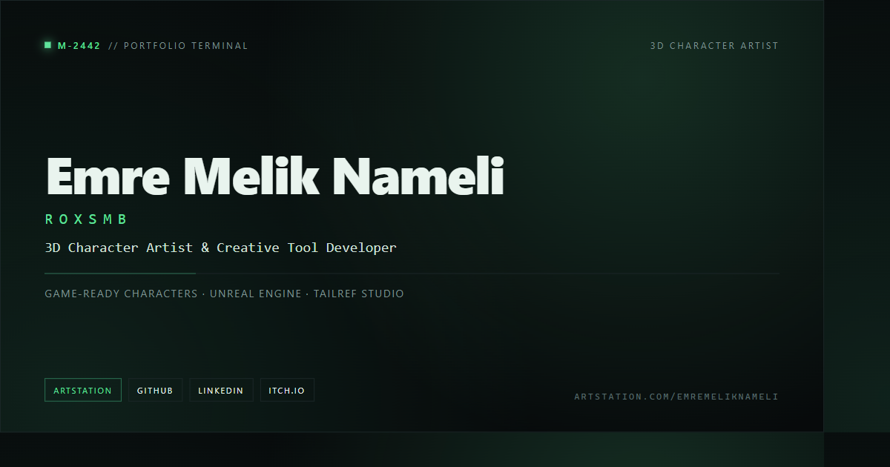

# Emre Melik Nameli (ROXSMB) — Portfolio

Source of **[roxsmb.github.io](https://roxsmb.github.io/)** — an interactive CRT-terminal portfolio for 3D character art, written as plain HTML, CSS and JavaScript with no build step and no runtime dependencies.

<div align="center">
  <a href="https://roxsmb.github.io/"></a>
</div>

## What is on the page

- **Work rail** — selected 3D characters and environments, each opening into the television set.
- **TailRef Studio bay** — the reference-board tool, with a live demo loop.
- **DVD bay** — a case for the short film **TFHDB**; pressing it parks the portfolio and plays the film inside the TV.
- **Dial, switch and lamp** — the interactive shell that ties the pieces together.

## Stack

| Layer | Detail |
| --- | --- |
| Markup and styling | Hand-written HTML and CSS, self-hosted woff2 fonts |
| Behaviour | Vanilla JavaScript, no framework, no bundler |
| Media | WebP stills, GIF demos, a lazily created YouTube iframe |
| Hosting | GitHub Pages, `main` branch, repository root |

The page loads no third-party script. The YouTube player is injected only after the DVD case is pressed, so a normal visit makes no request to YouTube.

## Preview locally

```
python -m http.server 8099 --bind 127.0.0.1
```

Open <http://127.0.0.1:8099/>. Opening `index.html` from disk works for everything except the film: YouTube refuses to play inside a `file://` page, so the TV shows a local-preview slate with a link to YouTube.

## Checks

- Lighthouse on the live site: **Accessibility 100 · SEO 100 · Best Practices 100**.
- Keyboard, mouse and touch paths are covered, including Escape to leave the film.
- `node --check assets/main.js assets/ship.js` before publishing; bump the `?v=` query on edited assets.

Deployment notes and file layout live in **[DEPLOY.md](DEPLOY.md)**.

## Elsewhere

**[Portfolio](https://roxsmb.github.io/)** · **[ArtStation](https://www.artstation.com/emremeliknameli)** · **[LinkedIn](https://www.linkedin.com/in/emre-melik-nameli-1026a0224/)** · **[itch.io](https://roxsmb.itch.io/)**

<sub>© Emre Melik Nameli (ROXSMB)</sub>
