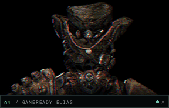
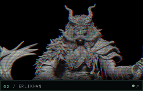
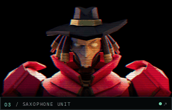
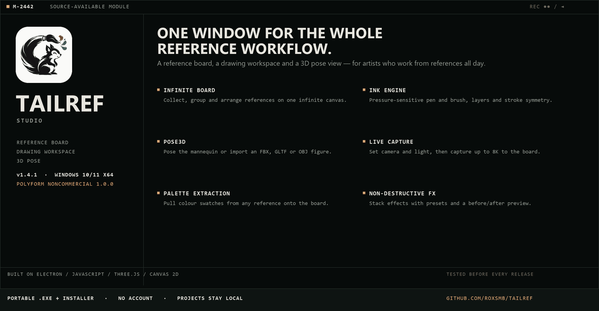

# Emre Melik Nameli (ROXSMB) — 3D Character Artist & Creative Tool Developer

Independent **3D character artist**, **animator** and **creative tool developer** for game studios and independent artists. I turn concept art into **game-ready characters** and **Unreal Engine** assets with **ZBrush**, **Maya**, **Substance Painter** and **TypeScript** tools like **TailRef Studio**.

**[Live Portfolio](https://roxsmb.github.io/)** · **[ArtStation Portfolio](https://www.artstation.com/emremeliknameli)** · **[Work With Me](#work-with-me)** · **[Selected Work](#selected-work)** · **[TailRef Studio](#tailref-studio)** · **[itch.io](https://roxsmb.itch.io/)** · **[LinkedIn](https://www.linkedin.com/in/emre-melik-nameli-1026a0224/)**

  

## Table of Contents

- [About](#about)
- [Work With Me](#work-with-me)
- [Selected Work](#selected-work)
- [TailRef Studio](#tailref-studio)
- [Tools & Skills](#tools--skills)
- [FAQ](#faq)
- [Connect](#connect)

## About

I am **Emre Melik Nameli** — also known as **ROXSMB**, **Roxsmb** or **Roxs.mb** — an independent **3D character artist**, **game artist** and **creative tool developer**. My **3D character art portfolio** covers **stylized and semi-realistic characters**, **game-ready modeling**, **PBR texturing**, **rigging**, **walk-cycle animation** and **Unreal Engine** integration.

I build assets that survive the trip from sculpt to engine: clean silhouettes, predictable topology, readable materials and exports that behave correctly in **Unreal Engine**. I also make artist-first tools such as **TailRef Studio**.

| Field | Detail |
| --- | --- |
| **Role** | Independent 3D Character Artist & Creative Tool Developer |
| **Toolchain** | ZBrush → Autodesk Maya → Substance Painter → Unreal Engine |
| **Tooling** | Electron · TypeScript · three.js · Canvas 2D |
| **Profiles** | [ArtStation](https://www.artstation.com/emremeliknameli) · [itch.io](https://roxsmb.itch.io/) · [LinkedIn](https://www.linkedin.com/in/emre-melik-nameli-1026a0224/) |

## Work With Me

Looking to hire a **freelance 3D character artist** for a game, cinematic or interactive project?

- **Game-ready character art** — high-poly sculpt, optimized mesh, UVs, PBR textures and engine-ready export.
- **Stylized & semi-realistic design** — silhouette, costume, prop detail and presentation renders.
- **Animation-ready assets** — rigging, walk cycles, pose studies and deformation checks.
- **Creative tools** — **Electron** / **TypeScript** desktop apps, **three.js** viewers and **Canvas 2D** interfaces.

**[Send a brief on ArtStation →](https://www.artstation.com/emremeliknameli)** or **[connect on LinkedIn](https://www.linkedin.com/in/emre-melik-nameli-1026a0224/)**.

## Selected Work

Three recent pieces from my **3D character art portfolio** on **[ArtStation](https://www.artstation.com/emremeliknameli)**.

  &nbsp;
  &nbsp;
  

**[Elias](https://www.artstation.com/artwork/eRE9qX)** — game-ready character and walk cycle · **[Erlikhan](https://www.artstation.com/artwork/AZOnny)** — character and industrial city · **[The Junk Collector](https://www.artstation.com/artwork/YGkZnq)** — stylized robot character. **[See all breakdowns on ArtStation →](https://www.artstation.com/emremeliknameli)**

## TailRef Studio

**TailRef Studio** is my flagship creative tool: a portable Windows app that combines a reference board, a drawing layer and a **Pose3D** view in one window.

  

- **Reference board + drawing layer** — organize references, stack/lock layers and mirror strokes.
- **Pose3D** — a **three.js** 3D pose reference beside the board.
- **Local-first** — `.tail` board files, portable `.exe`, no installer or account; boards stay on your machine.
- **Built with** — **Electron**, **TypeScript**, **three.js**, **Canvas 2D**.
- **Status** — v1.4.0, Windows x64, MIT; public source release not on GitHub yet.

For a build preview or tool feedback, message me on **[ArtStation](https://www.artstation.com/emremeliknameli)** or **[LinkedIn](https://www.linkedin.com/in/emre-melik-nameli-1026a0224/)**.

## Tools & Skills

| Discipline | Tools |
| --- | --- |
| **3D sculpting** | **ZBrush** |
| **Modeling, retopology, rigging** | **Autodesk Maya** |
| **PBR texturing** | **Substance Painter** |
| **Real-time engine** | **Unreal Engine** |
| **Creative apps** | **Electron**, **TypeScript**, **three.js**, **Canvas 2D** |

## FAQ

### Who is Emre Melik Nameli (ROXSMB)?
**Emre Melik Nameli** — also known as **ROXSMB** and **Roxsmb** — is an independent **3D character artist**, animator and creative tool developer. His work covers game-ready characters, PBR texturing, animation studies and artist-first software.

### What is TailRef Studio?
**TailRef Studio** is a local-first desktop reference board for artists. It combines an infinite board, a drawing layer and a **Pose3D** view, with built-in **Pinterest** and **ArtStation** panels. Built with **Electron**, **TypeScript**, **three.js** and **Canvas 2D**.

### Which 3D software do you use?
**ZBrush** for sculpting, **Autodesk Maya** for modeling, retopology and rigging, **Substance Painter** for PBR texturing and **Unreal Engine** for real-time validation.

### Can you rig and animate characters for Unreal Engine?
Yes. The pipeline includes **rigging**, **walk cycles**, **pose studies** and **Unreal Engine**-ready exports. Final scope depends on the character and animation set.

### How can I hire you or see more work?
See the **[ArtStation portfolio](https://www.artstation.com/emremeliknameli)** or send a brief via **[ArtStation](https://www.artstation.com/emremeliknameli)** / **[LinkedIn](https://www.linkedin.com/in/emre-melik-nameli-1026a0224/)**. Games and experiments are on **[itch.io](https://roxsmb.itch.io/)**.

## Connect

Let's build something that looks good and ships clean.

- **ArtStation:** [artstation.com/emremeliknameli](https://www.artstation.com/emremeliknameli)
- **itch.io:** [roxsmb.itch.io](https://roxsmb.itch.io/)
- **LinkedIn:** [linkedin.com/in/emre-melik-nameli-1026a0224](https://www.linkedin.com/in/emre-melik-nameli-1026a0224/)
- **GitHub:** [github.com/Roxsmb](https://github.com/Roxsmb)
- **Reddit:** [reddit.com/user/Roxsmb](https://www.reddit.com/user/Roxsmb/)
- **Buy Me a Coffee:** [buymeacoffee.com/roxsmb](https://buymeacoffee.com/roxsmb)

For **3D character art**, game-ready asset production, animation or creative tool collaborations, message me on ArtStation or LinkedIn.

---

M-2442 // PROFILE TERMINAL · © Emre Melik Nameli (ROXSMB) · Static GitHub Profile README, no build step.
